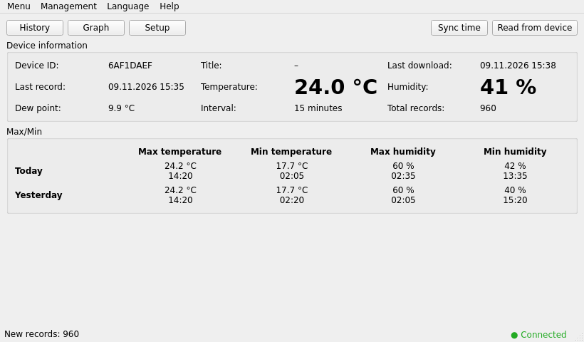
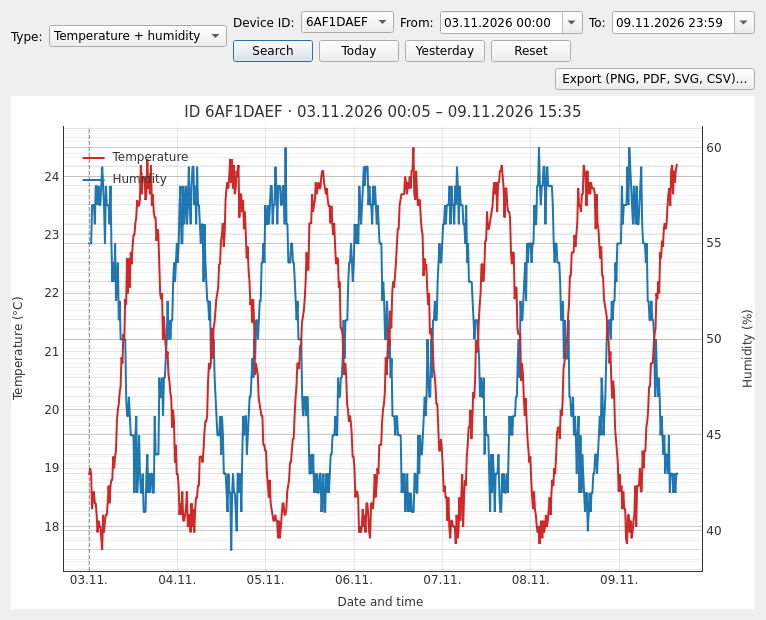
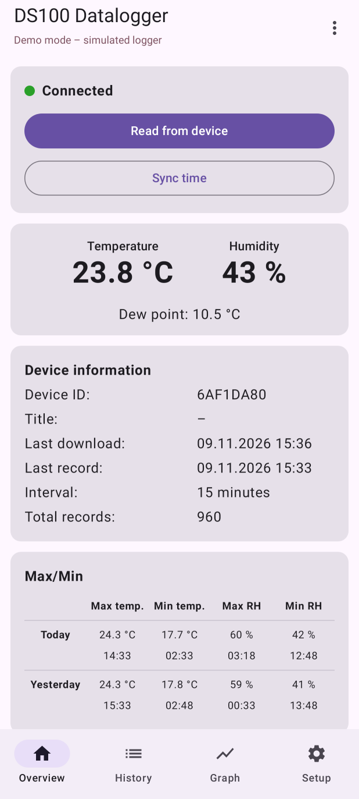
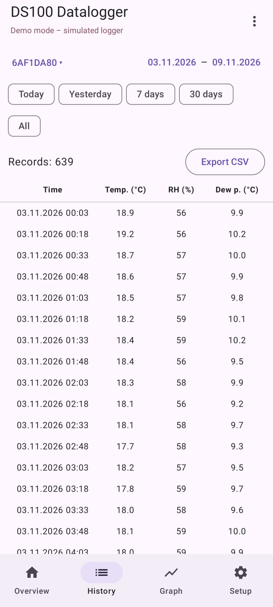
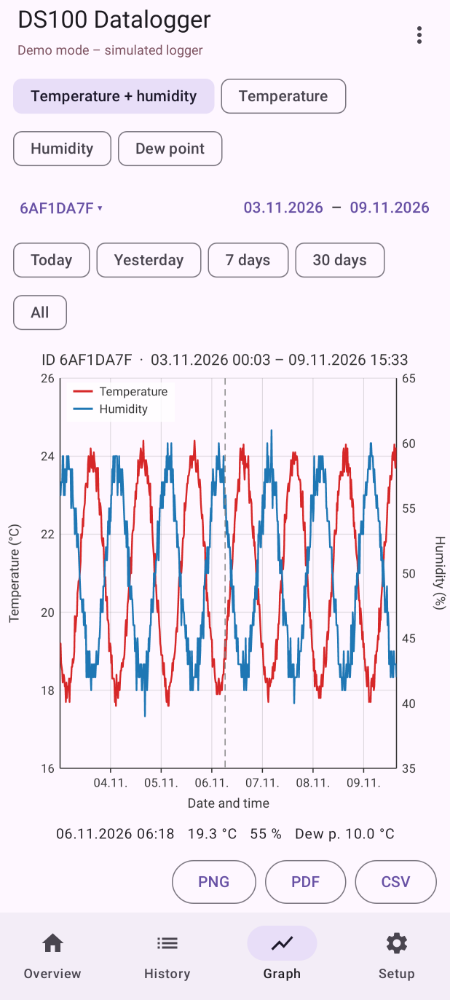
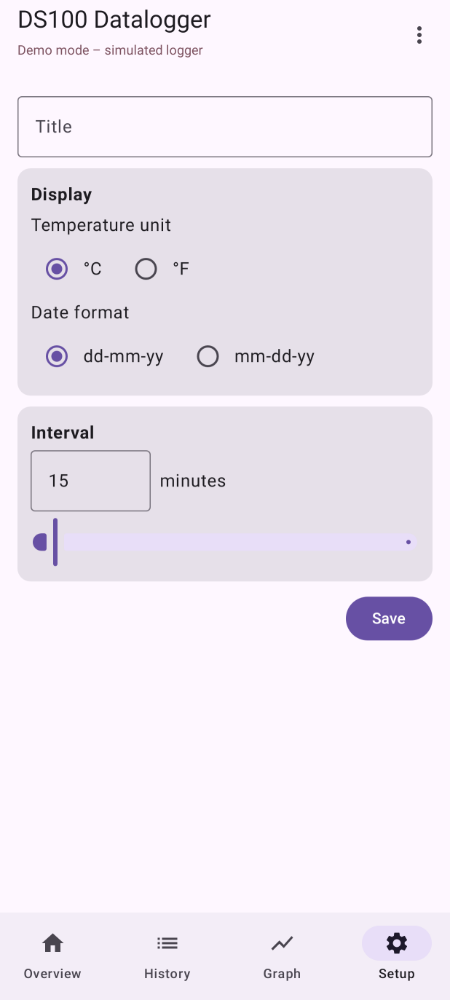

# DS100 Datalogger for Linux and Android

Open-source replacement for the Windows program **DataLogger V2.70** that comes with the
**DS100** USB temperature and humidity logger (USB ID `1941:8021`, sold for example by Pollin).

It reads the logger, keeps the history in a local database and shows it as a table and a
graph. It also changes the logger settings exactly like the Windows program does.

### Linux

| Main window | Graph |
|---|---|
|  |  |

### Android

| Overview | History | Graph | Setup |
|---|---|---|---|
|  |  |  |  |

## Features

Both apps have the same functions as the Windows program:

* **Download** – reads the logger when it is plugged in; the first download reads the whole
  memory, later ones only the new records.
* **Overview** – current temperature, humidity and dew point, device ID, interval, number of
  records, last download, max/min of today and yesterday.
* **History** – records of a chosen period (own dates or quick buttons: today, yesterday,
  all; Android also 7 and 30 days), export to CSV.
* **Graph** – temperature + humidity (two axes), temperature, humidity or dew point; values
  under the mouse/finger; export to PNG, PDF and CSV (Linux also SVG).
* **Setup** – title, temperature unit (°C/°F) and date format shown on the logger LCD,
  logging interval 1–240 minutes (written to the logger).
* **Sync time** – sets the logger clock to the computer/phone clock.
* **Management** – remove a device or its history from the database, erase the logger memory.
* Several loggers (told apart by their ID), English and Slovak UI, demo mode with a
  simulated logger.

## Download

Get the files from the [latest release](https://github.com/Dehumanizer77/ds100/releases/latest):

* `ds100-linux-1.1.zip` – Linux app
* `ds100-datalogger-1.1.apk` – Android app

## Linux

Needs Python 3.10 or newer with the `venv` module and an internet connection for the
installation (PySide6 and pyqtgraph are downloaded into a private virtual environment).

```sh
unzip ds100-linux-1.1.zip
cd ds100-linux
./install.sh
```

`install.sh` needs no root. It creates `venv/` in this folder and adds **DS100 Datalogger**
to the application menu. To use the logger without `sudo`, install the udev rule once:

```sh
sudo cp 70-ds100.rules /etc/udev/rules.d/
sudo udevadm control --reload-rules
```

and unplug and replug the logger. Then start the app:

```sh
./ds100gui.sh              # or "DS100 Datalogger" in the menu
./ds100gui.sh --simulate   # without a logger, with simulated data
```

Data are stored in `~/.local/share/ds100/datalogger.db` (SQLite), settings in
`~/.config/ds100/ds100gui.conf`. The UI language follows the system language and can be
changed in the *Language* menu.

### Command line

```sh
venv/bin/python ds100.py info                        # settings and device ID
venv/bin/python ds100.py csv data.csv                # download the whole history to CSV
venv/bin/python ds100.py set --interval 30 --unit C --date dmy
venv/bin/python ds100.py sync                        # set the logger clock
venv/bin/python ds100.py dump memory.bin             # raw memory dump (read only)
```

### Troubleshooting

| Problem | Fix |
|---|---|
| `Permission denied: '/dev/hidrawN'` | install the udev rule (above), close the app, replug the logger |
| `ensurepip is not available` | `sudo apt install python3-venv` (Ubuntu 24.04: `python3.12-venv`), run `./install.sh` again |
| the window does not open, error about the Qt plugin "xcb" | `sudo apt install libxcb-cursor0` |
| *Sync time* waits | normal: the logger takes the new time only every now and then, the app keeps trying for up to 3 minutes |

## Android

Needs Android 7.0 or newer with **USB OTG** support and an OTG adapter (USB-C or micro-USB
to USB-A).

1. Copy `ds100-datalogger-1.1.apk` to the phone and open it; allow installing apps from that
   source when Android asks.
2. Plug the logger in with the OTG adapter.
3. Android asks whether to open **DS100 Datalogger** – confirm (tick "always" so it does not
   ask again). The app reads the logger by itself.

The APK is signed with a development key, so Play Protect may call it an unknown app.
The data are kept inside the app; export them to CSV before uninstalling it.

## Building from source

### Linux

```sh
cd linux
./install.sh
venv/bin/python tests/test_device.py                   # protocol and memory logic
QT_QPA_PLATFORM=offscreen venv/bin/python tests/test_ui.py /tmp/ds100-test   # GUI checks
```

### Android

Needs JDK 17 or newer and the Android SDK (platform 35, build-tools 35.0.0).

```sh
cd android
echo "sdk.dir=$HOME/Android/Sdk" > local.properties
./gradlew testDebugUnitTest assembleRelease
```

The APK is written to `app/build/outputs/apk/release/`. The unit tests include
Robolectric/Roborazzi screenshots of all screens in demo mode (`app/build/shots/`).

## Repository layout

```
linux/      Linux app (Python, PySide6, pyqtgraph) and command-line tool
android/    Android app (Kotlin, Jetpack Compose)
docs/       USB protocol and memory map, screenshots
```

## How it works

The logger is a USB HID device that behaves like a 64 KiB memory: the PC reads and writes
32-byte blocks. The header holds the settings and the device ID, the rest is a ring buffer of
4-byte records (temperature, humidity, minutes since the previous record). Details are in
[docs/protocol.md](docs/protocol.md).

## Status

* The Linux app is used with a real DS100 logger (download, graphs, setup, time sync).
* The Android app is tested with the built-in simulated logger (unit tests and screenshot
  tests); please report problems with real phones. PDF export on Android could not be tested
  automatically.

This project is not affiliated with the manufacturer of the DS100 or of DataLogger V2.70.
